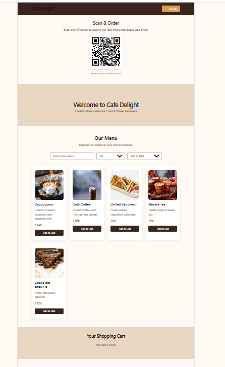
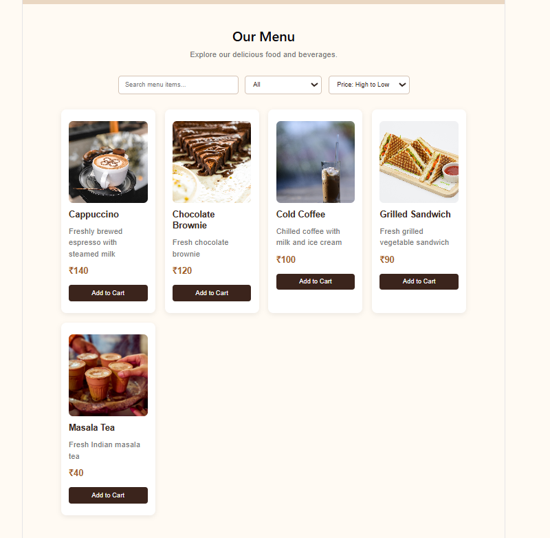
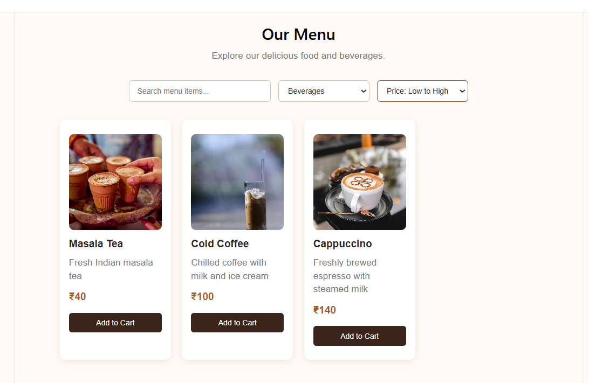
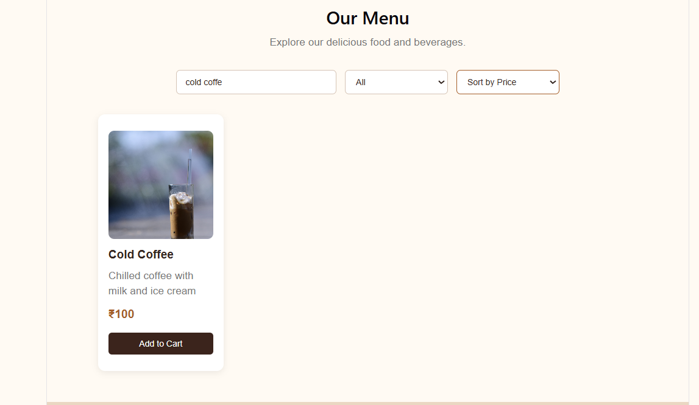
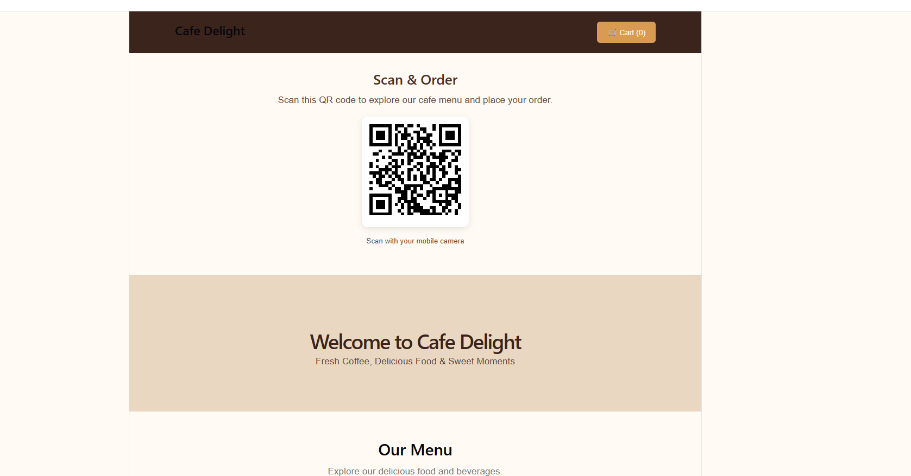
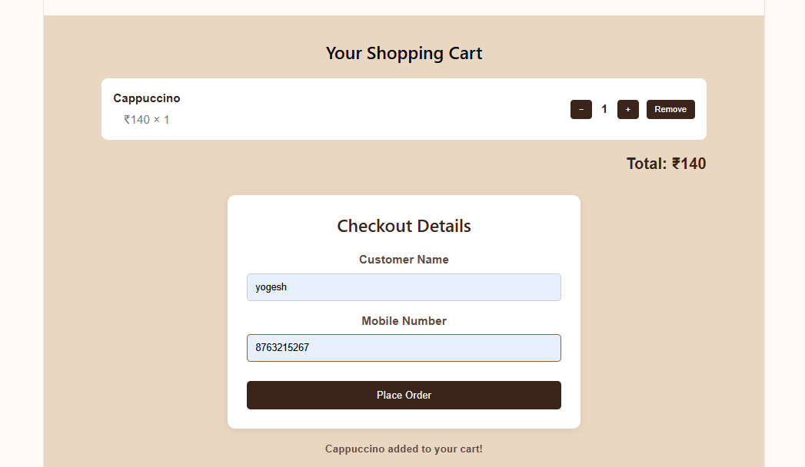
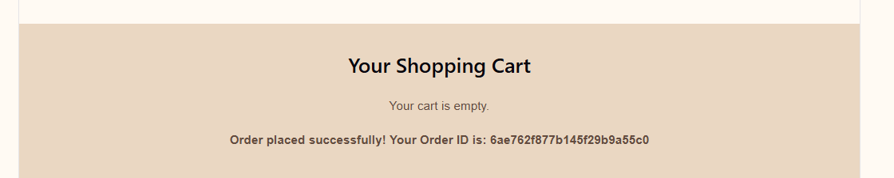

# Cafe Menu & Order Management System

A full-stack Cafe Menu and Order Management System built using the MERN Stack (MongoDB, Express.js, React.js, Node.js).

## Live Project Links

- **Frontend:** https://cafe-menu-order-gamma.vercel.app/
- **Backend:** https://cafe-menu-order.onrender.com/
- **Swagger API Documentation:** https://cafe-menu-order.onrender.com/api/docs

## Features

### Customer Features

- View cafe menu items dynamically.
- Search menu items by name.
- Filter items by category.
- Sort items by price (Low to High / High to Low).
- Add items to cart.
- Increase or decrease item quantity.
- Remove items from cart.
- Automatically calculate total amount.
- Place orders using customer name and phone number.
- QR code for accessing the cafe menu.
- Checkout form for customer details.
- Display order and loading messages.

### Admin / Backend Features

- Add new menu items.
- View all menu items.
- Update menu items.
- Delete menu items.
- Place customer orders.
- Retrieve all customer orders.
- Update order status.
- API documentation using Swagger.
- Input validation and error handling.

## Technology Stack

### Frontend
- React.js
- JavaScript
- HTML
- CSS
- Axios
- React Router

### Backend
- Node.js
- Express.js
- REST APIs
- Mongoose

### Database
- MongoDB Atlas

### Tools
- Visual Studio Code
- Postman
- Swagger UI
- Git and GitHub
- Vercel
- Render
- cron-job.org

## Project Structure

cafe-menu-order/
│
├── backend/
│   ├── src/
│   │   ├── config/
│   │   ├── controllers/
│   │   ├── models/
│   │   └── routes/
│   ├── .env.example
│   ├── server.js
│   └── package.json
│
├── frontend/
│   ├── src/
│   ├── public/
│   ├── .env.example
│   └── package.json
│
├── .gitignore
└── README.md


## Installation and Setup

### 1. Clone Repository

```bash
git clone https://github.com/anjirathod24-tech/cafe-menu-order.git
cd cafe-menu-order
```

### 2. Backend Setup

```bash
cd backend
npm install
```

Create a `.env` file inside the backend folder using `.env.example` as a reference.

Configure your environment variables:

```env
PORT=5000
MONGO_URI=your_mongodb_atlas_connection_string
```

Start the backend server:

```bash
npm run dev
```

Backend runs at:

`http://localhost:5000`

### 3. Frontend Setup

Open another terminal:

```bash
cd frontend
npm install
```

Create a `.env` file inside the frontend folder using `.env.example` as a reference.

Configure the API URL:

```env
VITE_API_URL=http://localhost:5000
```

Start the frontend:

```bash
npm run dev
```

Frontend runs at:

`http://localhost:5173`

## API Endpoints

### Menu APIs

| Method | Endpoint | Description |
|---|---|---|
| GET | `/api/menu` | Get all menu items |
| POST | `/api/menu` | Add a menu item |
| PUT | `/api/menu/:id` | Update a menu item |
| DELETE | `/api/menu/:id` | Delete a menu item |

### Order APIs

| Method | Endpoint | Description |
|---|---|---|
| POST | `/api/orders` | Place a new order |
| GET | `/api/orders` | Get all customer orders |
| PUT | `/api/orders/:id/status` | Update order status |

## API Documentation

Swagger API documentation is available at:

https://cafe-menu-order.onrender.com/api/docs

## Database

MongoDB Atlas is used as the database host.

Mongoose models are used to manage:

- Menu items
- Customer orders
- Order items and quantities
- Prices and total amount
- Order status

## Deployment

- **Frontend:** Deployed on Vercel.
- **Backend:** Deployed on Render.
- **Database:** Hosted on MongoDB Atlas.
- **Scheduled Keep-Alive:** cron-job.org sends a scheduled HTTP request to the backend to help keep the Render service active.
## Screenshots

### Cafe Homepage


### Menu


### Menu Filter


### Search Menu


### QR Code


### Checkout


### Order Success


## Environment Variables

The project includes:

- `backend/.env.example`
- `frontend/.env.example`

Create your own `.env` files using these examples before running the project locally.

**Note:** Do not upload actual passwords, database credentials, or secret environment variables to GitHub.

## Author

Developed as a Cafe Menu & Order Management System project using the MERN Stack.

**GitHub Repository:**  
https://github.com/anjirathod24-tech/cafe-menu-order
